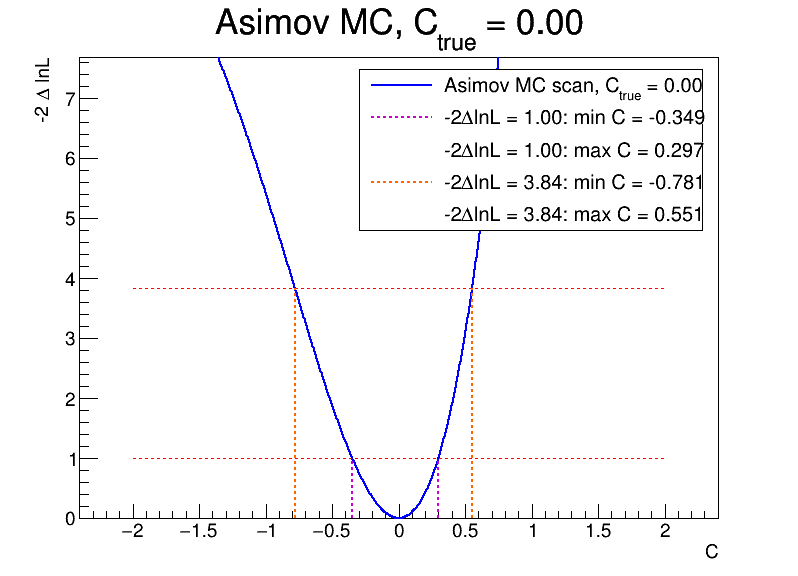
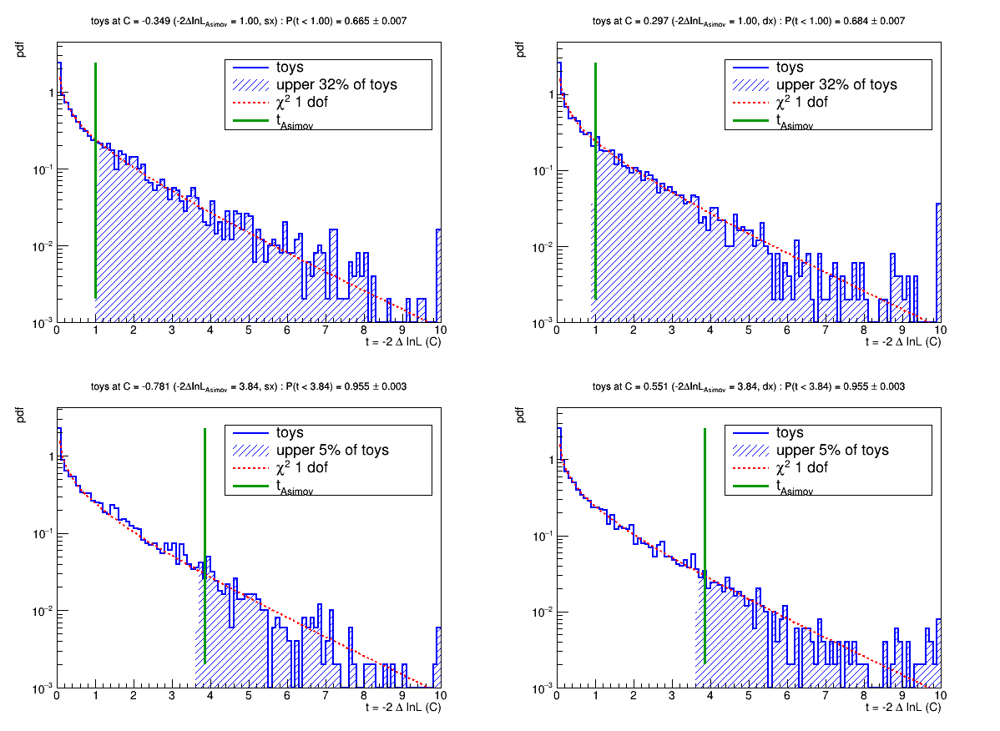
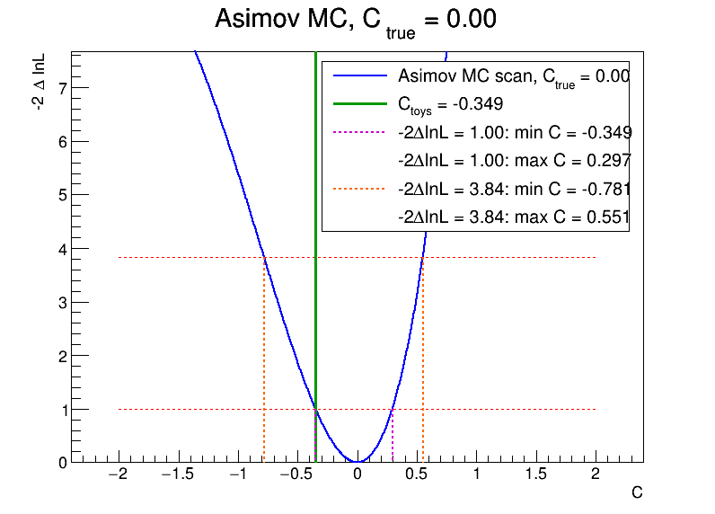
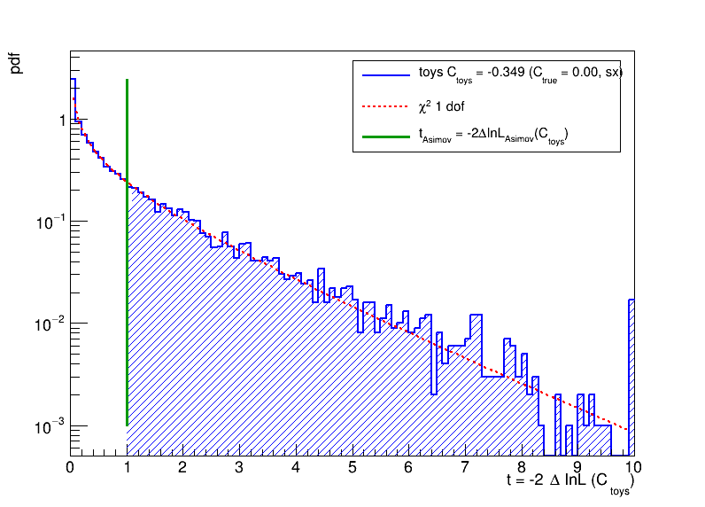
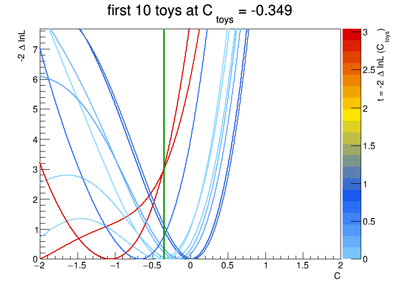
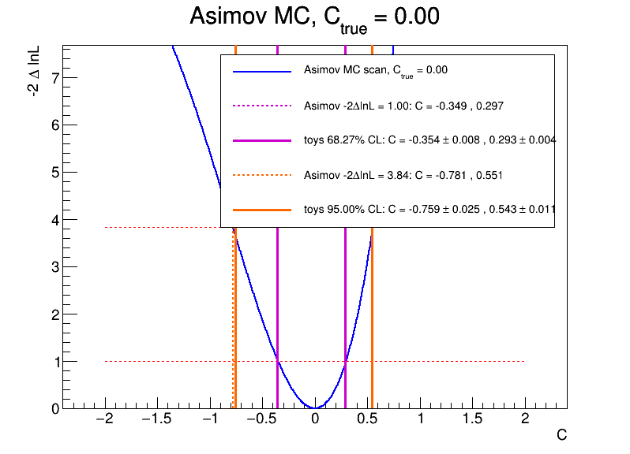
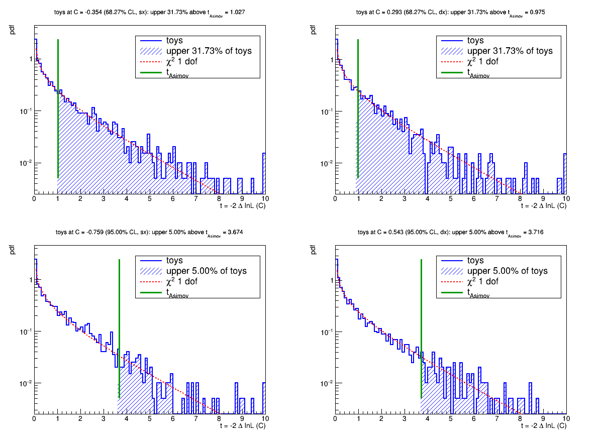

EFT coverage
====

Coverage of the -2DlnL < 1 (3.84) intervals for one EFT Wilson coefficient C.
Model, bin by bin, with L and Q from the histograms at C=+1 and C=-1:

    N(C) = SM + C * L + C^2 * Q

With the quadratic term the scan is not a parabola: does Wilks hold?
68% CL means: the true C is inside the window in 68% of the experiments.

Procedure:

    1) Asimov MC at C_true, data = N(C_true), likelihood scan -2DlnL(C) in [c_min, c_max]
    2) C_test = crossing of the Asimov scan at -2DlnL = 1 (3.84), left (sx) or right (dx)
    3) toys at C_test, for each toy:
         find C_hat for which -2lnL is minimum
         t = -2DlnL(C_test) = -2 ln [ L(C_test) / L(C_hat) ]

On the Asimov t = 1 (3.84) at C_test by construction. If Wilks holds, t is chi2 with 1 dof:
fraction of toys with t < 1 (3.84) = 68.27% (95%), 68.27% (95%) quantile of t = 1 (3.84).

NB: -2lnL is the likelihood ratio to the saturated model, as in FCCee-EFT likelihood.cxx
(https://github.com/UniMiBAnalyses/FCCee-EFT):

    -2lnL(C) = -2 ln [ L(C) / L_sat ] = 2 * sum_i [ N_i(C) - n_i + n_i * ln( n_i / N_i(C) ) ]

L_sat depends only on data and cancels in t. The minimum is found with a grid scan in [c_min, c_max] + refinement,
because with the quadratic term there can be 2 minima.

NB: one C range, [c_min, c_max] (default [-2, 2], 1000 points, fixed), for the Asimov scan, the crossings
and the minimum in the toys. A warning is printed if toys have the minimum at the boundary of the range.

Create test input (input.root with histo_SM, histo_cP1, histo_cM1):

    root -l -b -q createTestInput.cxx

Run, all the 4 tests, -2DlnL = 1 sx and dx, -2DlnL = 3.84 sx and dx, coverageComplete.cxx(..., C_true, n_toys, c_min, c_max):

    root -l coverageComplete.cxx
    root -l 'coverageComplete.cxx("input.root", "histo_SM", "histo_cP1", "histo_cM1", 0., 5000)'

Output:

    summary on screen: C_test, t_Asimov, fraction of toys with t < t_Asimov, quantile of t
    canvas cc_asimov: Asimov scan with the crossings (coverageComplete_asimov.png)
    canvas cc_t:      t from toys vs chi2 1 dof, one pad per test, upper 32% (5%) shaded (coverageComplete_t.png)

Example, test input, C_true = 0, 5000 toys per test:

    -2DlnL = 1    sx : C_test = -0.349 , fraction t < 1    = 66.5 +/- 0.7 % (Wilks 68.27 %)
    -2DlnL = 1    dx : C_test =  0.297 , fraction t < 1    = 68.4 +/- 0.7 %
    -2DlnL = 3.84 sx : C_test = -0.781 , fraction t < 3.84 = 95.5 +/- 0.3 % (Wilks 95 %)
    -2DlnL = 3.84 dx : C_test =  0.551 , fraction t < 3.84 = 95.5 +/- 0.3 %

Asimov scan at C_true = 0: the 4 crossings (dashed) are the C where the toys are generated:

t from the toys at the 4 crossings (blue), chi2 1 dof (red, Wilks), t_Asimov (green, = 1 or 3.84 by construction),
upper 32% (5%) of the toys shaded: if Wilks holds the shaded area starts at t_Asimov:

Run, one test only, -2DlnL = 1, left or right, coverage.cxx(..., C_true, n_toys, c_min, c_max, side):

    root -l coverage.cxx
    root -l 'coverage.cxx("input.root", "histo_SM", "histo_cP1", "histo_cM1", 0., 10000)'
    root -l 'coverage.cxx("input.root", "histo_SM", "histo_cP1", "histo_cM1", 0., 10000, -2, 2, "dx")'

Output: t from toys vs chi2 1 dof, upper 32% shaded (coverage.png), Asimov scan (coverage_asimov.png),
likelihood scan of the first 10 toys (coverage_toy_scan.png).

Example, test input, C_true = 0, 10000 toys, sx: C_toys = -0.349 , fraction t < 1 = 67.2 +/- 0.5 % (Wilks 68.27 %).

Asimov scan at C_true = 0, toys generated at C_toys (green, -2DlnL = 1 crossing on the left):

t from the toys at C_toys (blue), chi2 1 dof (red), t_Asimov = 1 (green), upper 32% of the toys shaded:

Likelihood scan of the first 10 toys, color = t = -2DlnL(C_toys) of the toy (light blue/blue small t, yellow/red large t),
C_toys in green. Some toys have a second minimum, or the minimum at the boundary of [c_min, c_max]:

Run, measurement of the interval edges with toys (Neyman), left (sx) and right (dx), coverageMeasurement.cxx(..., C_true, n_toys, c_min, c_max):

    root -l coverageMeasurement.cxx
    root -l 'coverageMeasurement.cxx("input.root", "histo_SM", "histo_cP1", "histo_cM1", 0., 20000, -2, 2)'

Where, for a given C: t_Asimov(C) = -2DlnL_Asimov(C), q(C) = quantile of t from toys at C with 31.73% (5%) of toys above.
The edge of the 68.27% (95%) CL interval is where t_Asimov(C) = q(C). Start from the Asimov crossing at 1 (3.84),
move C in steps till t_Asimov(C) - q(C) changes sign, then bisection. Same random seed for every C.
If Wilks holds the measured C is the Asimov crossing.

Output:

    summary on screen: Asimov crossing vs measured C, with stat. uncertainty from the toys (approximate)
    canvas cc_t:      t from toys at the 4 measured C, upper 31.73% (5%) shaded (coverageMeasurement_t.png)
    canvas cc_asimov: Asimov scan, Asimov crossings (dashed) and measured C (solid) (coverageMeasurement_asimov.png)

Example, test input, C_true = 0, 20000 toys per point:

    68.27% CL sx : Asimov C = -0.349 , toys C = -0.365 +/- 0.003
    68.27% CL dx : Asimov C =  0.297 , toys C =  0.294 +/- 0.002
    95%    CL sx : Asimov C = -0.781 , toys C = -0.767 +/- 0.006
    95%    CL dx : Asimov C =  0.551 , toys C =  0.546 +/- 0.003

Asimov scan at C_true = 0: Asimov crossings (Wilks, dashed) and edges measured with the toys (solid),
68.27% CL magenta, 95% CL orange:

t from the toys at the 4 measured C: by construction the upper 31.73% (5%) of the toys starts at t_Asimov (green):

NB: root files are not in the repository, regenerate them with the commands above.
The plots in images/ are copies of the png produced by the commands of the examples.
